I build web applications end to end — from the database to the interface.
Started my apprenticeship in August 2023, finishing with the EFZ in 2027.

  
  
  

---

### About

Final-year apprentice, preparing for my IPA. Most of what I build are web apps for real businesses: expenses, catering and customer leads.
**Open to work from 2027.**

I speak **German · English · Arabic**.

### Stack

**Languages**

  
  
  
  
  
  

**Frameworks**

  
  
  
  
  
  

**Data & hosting**

  
  
  
  
  
  

### Things I've built

| Project | What it does | Stack |
|---|---|---|
| **Expense app (IPA)** | My final apprenticeship project: expense app with a multi-step approval flow (employee, manager, CEO, accounting). | React · Vite → C# / ASP.NET Core |
| **Catering manager** | Manages catering requests and offers for a restaurant, so admin, kitchen and service know what each event needs. | Next.js · TypeScript · Tailwind |
| **Tell Autoankauf** | Website for a Swiss car-buying service: lead form with photo upload, e-mail alerts and an admin dashboard with an AI price estimate. | Next.js · Prisma · Neon · Resend · Vercel |
| **Schnitzeljagd App** | Mobile scavenger hunt game using GPS, QR codes and device sensors. | Ionic · Angular · Capacitor |

Most of these are private client or company projects — happy to show them in person.
